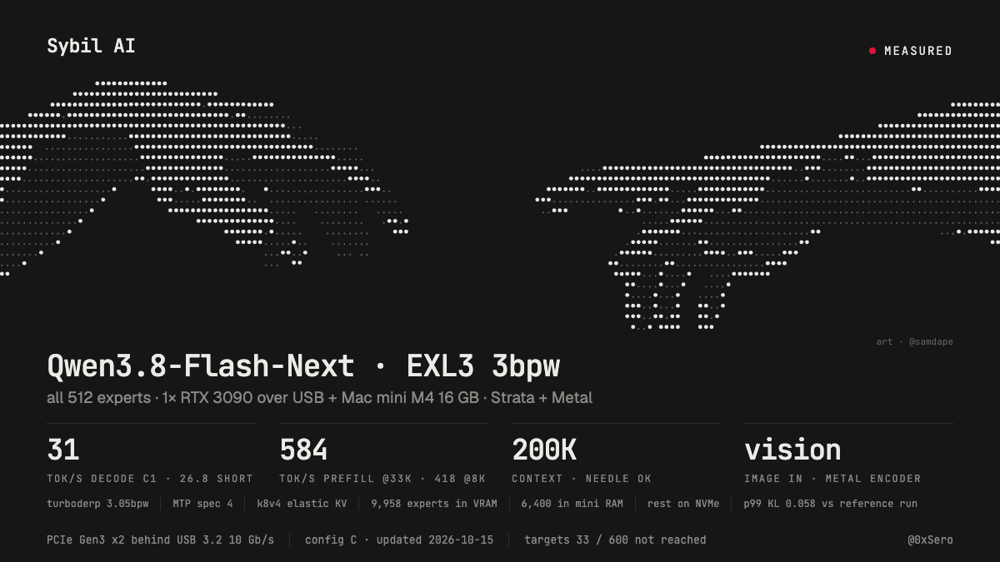

PREREQUISITES: 

- Tinygrad's Chestnut eGPU: https://comma.ai/shop/chestnut - 250$ + tax
- M4 Mac Mini 16GB RAM / 256GB SSD:  900$ + tax
- RTX 3090 24 GB VRAM: 1100$ + tax
- Model: Qwen 3.8 Flash in exl3-3bpw by turboderp: https://huggingface.co/turboderp/Qwen3.8-Flash-Next-exl3/tree/3.05bpw_h5_ng5

Total Cost: 2250$ + Tax and Shipping
Peak power consumption: 450w/h

Model scores 40 on AA, on Max reasoning it's tying GPT-5.6-Sol low & Opus-4.8 low 
This is still rather unoptimised, I for a 3090 I would recommend running Qwen3.8-27B you'll get 5-6x better performance. 


# qwen38-flash-next-3090-usb-offload



Run **Qwen3.8-Flash-Next** (EXL3 3.05 bpw, 48 MoE layers x 512 experts, 45.8 GB of experts, all of them computed, none pruned) with a **200K context**,
**image input** and **MTP speculative decoding** on one **RTX 3090 24 GB attached to a Mac mini M4 (16 GiB) through a USB dock**. The GPU holds the
hottest experts and the attention; the mini computes the other experts on its own GPU (Metal) from an LRU of registered RAM slots and an NVMe drive.
The engine is [Strata](https://github.com/Niko1221/Strata) v0.1.41 plus the patches here, running on macOS through a CUDA-runtime shim ("tgcu") on
tinygrad's NV backend.

## One-click

```sh
docker compose run --rm build      # any machine with Docker (linux/arm64): the pinned CUDA 13.4 build -> ./out (fatbins, patched Strata, configure tree); 3 min cold on an M-series Mac, seconds when cached
docker compose --profile fetch run --rm fetch all    # optional, ~130 GB: experts (sha256-checked against results/pack/exl3_pack.json) + dense GGUF and mmproj (sha256-checked)
./run.sh                           # on the Mac mini: installs the bundle, builds the macOS libraries and the engine, renders config L, checks the host prerequisites, starts the server
./run.sh --check                   # the same, without starting the engine or touching USB
./run.sh --config final-g4-lru-ht  # an older config (fallbacks, see below)
```

(`docker compose build build` first when the repo changed: `run` reuses the image.) `./run.sh` defaults to **config L** (config AM = `--config am`, config S2 = `--config s2`, config H = `--config h`, config G = `--config g`; L = AM + `STRATA_KVT_LAZY=0` and `STRATA_PF_MAC_QMIN_TOK=3000`, patches 0031/0032, `configs/strata-exl3-full512-l.json.tmpl`; AM = S2 + `STRATA_PF_ALIGN=131072` with `STRATA_PF_ALIGN_MAXT=2048`, patch 0030, `configs/strata-exl3-full512-am.json.tmpl`; S2 = H + `--prefill 3072` with `STRATA_PF_BIG_MIN=28000`, the 5-bit lane transport `STRATA_PF_XPORT_BITS=5`, `STRATA_PF_GRP_FIT=1` and `STRATA_PF_SPLIT2=1`, patches 0026-0029, `configs/strata-exl3-full512-s2.json.tmpl`; H = G + the idle-only SSD-parked conversation cache, patch 0025, [`docs/park-cache.md`](docs/park-cache.md); config F = `--config f`, config E = `--config e`, config D = `--config d`, config C = `--config c`; G adds the Opt23 doorbell, patch 0024 + `libstrata_o23` (x pulled as fp16, device-side skip of rings with no cold expert), and the fused-decode Metal prefill GEMM to F; F adds the asynchronous USB batches of the shim, `shim/0006` + `libtgusb`, and the Prefill20/21 patches 0022/0023 to E's decode hoist, patch 0021, and D's lazy refill, patch 0020) (`configs/strata-exl3-full512-l.json.tmpl`, below), the recommended recipe. Host prerequisites it checks and prints
(nothing is stored, no password is asked for):

```sh
sudo sysctl iogpu.wired_limit_mb=14336 vm.global_user_wire_limit=15032385536 vm.user_wire_limit=15032385536   # once per boot (it resets on reboot): the 6,400-slot mini-side expert LRU locks 12.0 GB
caffeinate -dimsu &                # no idle sleep (run.sh starts it when none runs; `./run.sh stop` ends it): an idle-sleeping mini froze the engine for minutes during the campaign
# STRATA_EXL3_METAL_SLOTS 6400 is in the config; free disk: a few GiB for swap and logs, ~190 GB on a fresh install
```

The serving runtime is native macOS (the engine drives the 3090 over USB through libusb and computes the cold experts with Metal), and Docker on a Mac runs a Linux VM with no Metal and no
USB passthrough of this dock, so Docker makes the build and the model download one command but cannot run the server; `./run.sh` is the one native step. Two Metal binaries need Xcode's Metal toolchain,
which the mini's Command Line Tools lack: `./run.sh --build-metal` builds them on any Mac that has it (into `./out/metal`; copy that directory to the mini). What was run and what was not: [docs/reproduce.md](docs/reproduce.md#10-one-click-what-was-run) and [section 11](docs/reproduce.md#11-config-c-what-was-reproduced).

## Results: config L (default), config AM, config S2, config H, config G, config F, config E, config D and config C

Config L (2026-10-30, production on the mini since 11:49Z) = config AM + two changes, engine `strata_o37j`: after a long prompt the K/V trim no longer refills the freed expert slots before the next request (`STRATA_KVT_LAZY=0`, `patches/strata/0031`: they refill at idle, the Mac computes those experts meanwhile), and prompts under 3000 tokens read only the experts they route to (`STRATA_PF_MAC_QMIN_TOK=3000`, `0032`) instead of every expert the GPU does not hold.
Measured 2026-10-30: **first request of another conversation after a 128K prompt 11.6 s -> 4.5 s prompt time; 1000-token prompts 8.51 -> 7.19 s (+18 %); agent turns -3.4 % (ABBA AM L L AM)**; the standard rows (2.5K / 8K / 18K / 33K: 251.3 / 711.7 / 787.3 / 951.1 tok/s) and TTFT unchanged; decode 33.20 vs 33.36 (within AM's spread), probes right after the long rows -1.2 %; quality gate PASS (p99 0.0955 as AM); regression (190K needle, image, tool reuse, 5 x 32K) and the 14-prompt soak pass with 0 GPU timeouts.
Every table: [`docs/results.md`](docs/results.md) section 0.00000000, [`patches/README.md`](patches/README.md) (Config L), hashes [`results/verification/config-l-sha256.txt`](results/verification/config-l-sha256.txt).

Config AM (2026-10-30, production on the mini since 05:10Z) = config S2 + one prefill change (`patches/strata/0030`, engine `strata_o37f`): the prompt path's borrowed buffers of >= 2 MiB start on a 128 KiB boundary for 2048-token chunks (`STRATA_PF_ALIGN=131072`, `STRATA_PF_ALIGN_MAXT=2048`). The loan begins at an expert-cache slot (1,862,400 B, not page-aligned), so before it every buffer's page offset moved with the loan.
Measured 2026-10-30, ABBA S AM AM S with a fresh restart per arm: **prefill (warm, tok/s) 2.5K 250.6 -> 252.3, 8K 703.8 -> 710.0, 18K 767.1 -> 787.8 (+2.7 %), 33K 950.9 -> 947.7 (within S2's spread)**; decode 33.4 and TTFT 14.8 s unchanged; quality gate as S2; regression (190K needle, image, tool reuse, 5 x 32K) and the 14-prompt soak pass with 0 GPU timeouts.
Every table: [`docs/results.md`](docs/results.md) section 0.0000000, [`patches/README.md`](patches/README.md) (Config AM), hashes [`results/verification/config-am-sha256.txt`](results/verification/config-am-sha256.txt).

Config S2 (2026-10-29, production on the mini 2026-10-29 16:02Z .. 2026-10-30 05:10Z) = config H + four prefill changes, all on the Mac-lane prefill path (decode, weights, 200K context, vision and MTP unchanged): `--prefill 3072` with `STRATA_PF_BIG_MIN=28000` (prompts of >= 28K tokens run 3072-token chunks, shorter ones keep 2048; `patches/strata/0026`), the 5-bit block-32 lane transport `STRATA_PF_XPORT_BITS=5` (-35 % USB bytes per x/y row vs int8; `0027`), `STRATA_PF_GRP_FIT=1` (the mapped routing table sized to the chunk; `0028`) and `STRATA_PF_SPLIT2=1` (the next chunk's front queued on the 3090 before the x download; `0029`); template `configs/strata-exl3-full512-s2.json.tmpl`, live config md5 `6e897d7a`, engine `strata_o37a`. Lineage: G -> H (below: engine `strata_o24b`, idle-only SSD-parked conversation cache, `0025`) -> P35 (H + BIG_MIN + 5-bit + GRP_FIT, promoted 13:25Z) -> S2 (P35 + SPLIT2).
Measured 2026-10-29, ABBA with a fresh restart per arm: **prefill (warm, tok/s; H from ABBA H/IG/CX, P35 and S2 from ABBA P35/S2) 8K 654.9 (H) -> 686.0 (P35) -> 702.2 (S2), 33K 794.5 -> 928.5 -> 950.0 (+19.6 % vs H)**, 18K 735.5 -> 756.0 -> 767.5, 2.5K unchanged (~250); SPLIT2 alone +1.5..+2.7 % (ABBA P35 S2 S2 P35; it was modelled at +15-25 %: the 33K period is host-serial, not card-bound). Decode unchanged within noise (32.9-33.8 tok/s realistic across all arms), TTFT 15.1 -> 14.8 s. Regression on S2: realistic 33.50 tok/s (TTFT 14.80 s), tool reuse and image PASS, 190K needle found in 255 s (G 276 s), 5 x 32K found, 0 GPU timeouts; soak 14 x 32K + 190K all found. Quality: the 5-bit transport passes the 705-position gate (top-1 98.01 %, mean KL 0.006181, p99 0.0955 vs 0.1) and a 2,139-position panel against the fp16 lane (5-bit 98.27 % / KL 0.004077 / p99 0.0459; int8 98.50 % / 0.003590 / 0.0550); SPLIT2 is exact on every prompt that reaches it. The M27 Metal kernel was measured neutral twice and is not shipped.
Every table (raw logs not yet copied into `results/raw/`): [`docs/results.md`](docs/results.md) section 0.000000, [`patches/README.md`](patches/README.md) (Config S2), hashes [`results/verification/config-s2-sha256.txt`](results/verification/config-s2-sha256.txt).

### Config H

Config H = config G + the SSD-parked conversation cache (`patches/strata/0025`, flags `--ssd-park-mib 8192 --ssd-park-dir $HOME/strata-park`; engine `strata_o24b` md5 `b3a275ad`, live config md5 `fa0860bc`): a finished conversation is written to the SSD while the engine is idle, and switching back to it restores it instead of re-prefilling. Switch-back (A, 15 s pause, B, A): 30K 3.1 s vs 41-49 s, 100K 5.95 s vs 133-146 s, same text. Idle-only: a switch before the idle write finishes (~1.5 s + 2-5 s) is not parked. ABBA vs G: decode 33.47 vs 33.50 tok/s (neutral), prefill and regression equal (190K needle 273 s, 5 x 32K, image, tool reuse), quality gate 705/705 positions, p99 KL 0, soak PASS. Raw logs: [`results/raw/opt24/`](results/raw/opt24/); details [`docs/park-cache.md`](docs/park-cache.md); table: [`docs/results.md`](docs/results.md) section 0.00000.

### Config G

Config G = config F + the Opt23 doorbell (`patches/strata/0024`, `STRATA_O23=3`, `exl3/exl3_o23.cu` -> `libstrata_o23.dylib`: the card publishes x as fp16 into per-ring payload slots and skips the wait for the mini's rows on rings with no cold expert; bit-exact) + the fused-decode Metal prefill GEMM (`EXL3M_PF_FD=2`, `exl3/metal`: the EXL3 decode runs inside the GEMM's weight-tile load, no decoded-weight round trip through DRAM; bit-identical); template `configs/strata-exl3-full512-g.json.tmpl`, live config md5 `ff78909a`, engine `strata_o23b` md5 `05ec22e5`.
Measured 2026-10-18 on the mini (Opt23), ABBA with a fresh restart per arm (F G G F; 29 realistic prompts, 300 tokens, + 12 probes, prefill rows x4, agent turns): **decode 32.64 (F) -> 33.38 tok/s (+2.33 %, paired 26/29 prompts faster, se 0.51 %)**, probes 28.19 -> 28.91 (+2.56 %); **prefill 2,565 / 8,018 / 19,547 / 33,842 tokens 234 / 497 / 562 / 621 -> 240 / 606 / 703 / 762 tok/s (+2.6 / +22 / +25 / +22.7 %)**; agent turns 0.5-1.0 s faster at 60-400 new tokens. Full regression on the final config (75 requests): realistic 33.43 tok/s (TTFT 15.1 s, F 19.7 s), prefill 236 / 233, 564 / 650, 635 / 692, 741 / 795 tok/s (2,565 / 8,018 / 18,330 / 33,842 tokens, 2 runs each), tool reuse PASS (3,379 reused), image PASS, 190K needle found (276 s, F 352 s), 5 x 32K needles found, 5 x 33K soak 5/5, 0 GPU timeouts; quality gate vs the saved baseline (705 positions): top-1 97.73 %, mean KL 0.005474, p99 KL 0.0817 (PASS), log-probabilities identical to config F.
Raw logs: [`results/raw/opt23/`](results/raw/opt23/); every table: [`docs/results.md`](docs/results.md) section 0.0000; hash manifest and rebuild comparison: [`results/verification/config-g-sha256.txt`](results/verification/config-g-sha256.txt), [`config-g-repro.md`](results/verification/config-g-repro.md).

### Config F

Config F = config E + asynchronous USB batches in the shim (`patches/shim/0006`, `shim/tgusb.c` -> `libtgusb.dylib`; `TGCU_USB_NPIPE=1`, `TGCU_USB_SUBP=1`, `TGCU_USB_FUSE=1`, `TGCU_USB_FENCE=11`) + the Prefill20/21 engine patches (`patches/strata/0022`, `0023`: their new knobs are off or neutral in F); template `configs/strata-exl3-full512-f.json.tmpl`, live config md5 `b8d72f71`, engine `strata_p22` (= `strata_p21b`) md5 `4180585c`.
One USB transaction on the ASM2464 bridge costs ~85-90 us of round-trip latency (libusb sync control or bulk); config E paid ~175 control + ~60 bulk transfers per prompt chunk-layer and a handful per decode ring. `libtgusb` queues the transfers of one step asynchronously (arm + bulk, pushbuffer + ring entry + GPPut + doorbell, semaphore poll request + completion) and runs the upload / download round loops natively. Idle-card microbench (byte-exact): 5.3 MB y push 15.6 -> 9.0-10.7 ms, lazy x fetch 16.7 -> 13.7 ms, 108 KB push 1.04 -> 0.55 ms, 300 KB download 2.6 -> 1.1 ms. Order between the control endpoint and the bulk endpoints is **not** guaranteed by the bridge: the three fences of `TGCU_USB_FENCE=11` are required (fence 0 / 8 timed out under CPU load). Nothing is lossy: every routed expert stays at 3 bpw, all 512 per layer, no pruning; 200K context, vision and MTP stay.
Measured 2026-10-17 on the mini (Prefill22), ABBA with a fresh restart per arm (E F F E; 29 realistic prompts, 300 tokens, + 12 probes, prefill rows x2, agent turns): **decode 30.69 (E) -> 32.80 tok/s (+6.79 %, paired 28/29 prompts faster, se 0.78 %)**, probes 26.88 -> 27.88 (+3.7 %); prefill 2,565 / 8,018 / 19,547 / 33,842 tokens 220 / 484 / 534 / 598 -> 234 / 498 / 562 / 621 tok/s (+6.4 / +2.9 / +5.2 / +3.8 %); agent turns (60..400 new tokens) ~0.3 s faster each. Full regression on the final config (~110 requests): realistic 32.62 tok/s (TTFT 19.7 s), prefill 232 / 226, 470 / 527, 515 / 551, 606 / 639 tok/s (2,565 / 8,018 / 18,330 / 33,842 tokens, 2 runs each), tool reuse PASS (3,379 reused), image PASS, 190K needle found (352 s), 5 x 32K needles found (41-64 s), 0 GPU timeouts; guarded soak of 5 x 33K found; quality gate (teacher-forced, 705 positions): vs the saved baseline top-1 97.73 %, mean KL 0.005474, p99 KL 0.0817 (PASS, the same numbers as config E), vs config E top-1 100.00 %, KL 0 (the log-probabilities are identical); CPU-load byte-exact check (8 CPU hogs, 2 x 150 s of random-size uploads / downloads with pattern compare, fence 11): 26.3 + 26.4 GB moved, 0 mismatches.
Tried and **not** shipped (same campaign, [`results/raw/prefill22/`](results/raw/prefill22/)): the lazy shadow pool `TGCU_LAZY_POOL=3` (+0.9 % at 18K at best, and with it the teacher-forced quality flow crashes the engine deterministically: `bulk IN short read` in the decode ring; bisected: every arm without the pool passes, with it every arm fails), the PLE first-group warm-ahead `plew=1` (matched token counts, 4 ABBA repeats on fresh text: 8K -4.2 %, 18K +0.3 %, 33K +0.3 %; an earlier +6..+15 % came from unequal prompt lengths). Decode in the in-server screen (flag per request, ABBA by prompt, pool + npipe + subp + fuse vs none): +7.8 % realistic (se 2.7 %), +3.9 % probes.
Raw logs and tools: [`results/raw/prefill22/`](results/raw/prefill22/).

## Results: config E (decode hoist)

Config E = config D + the decode hoist (`patches/strata/0021`, `STRATA_D19_HOIST=1`; template `configs/strata-exl3-full512-e.json.tmpl`, live config md5 `078235c5`, engine `strata_d19b` md5 `8b11081b`).
In the EXL3 doorbell graph the shared-expert combine and the resident experts' down-projection kernel used to run after the wait for the mini's cold-expert rows although they do not depend on them; they now run before it, so only one add stays on the card's critical path between the y push and the next ring (HS_TRACE wait-for-ring 0.317 -> 0.282 ms per ring, 44 rings per window). Same arithmetic, the fp32 association of the layer output changes (as with any slot-count change). Prefill and the 200K / vision / MTP / all-512-expert stack are unchanged.
Measured 2026-10-16/17 on the mini (FewerTrips19), ABBA with a fresh restart per arm (C D E E D C; 29 realistic prompts, 300 tokens, + 12 probes per arm): **decode 29.81 (D) -> 30.94 tok/s (+3.8 %, paired 24/29 prompts faster, se 0.8 %)**, config C 31.14 (E -0.5 % vs C; probes 26.47 vs D 26.27 vs C 26.88), TTFT unchanged vs D (20.2 s vs C 23.8 s), image PASS on both E arms. Full regression on the final config (~110 requests): realistic 30.85 tok/s, prefill 2,565 / 8,018 / 18,330 / 33,842 tokens 230 / 224, 459 / 512, 491 / 520, 588 / 621 tok/s, tool reuse PASS, image PASS, 190K needle found (356 s), 5 x 32K needles found, 0 GPU timeouts; quality gate vs the saved baseline (705 positions): top-1 97.73 %, mean KL 0.005474, p99 KL 0.0817 (PASS; against the config D run p99 0.1267, informational as before).
Not shipped, measured / simulated in the same campaign ([`results/raw/fewertrips19/`](results/raw/fewertrips19/), tables in `sim/`): card-only self-speculative drafting (the card-only pass agrees with the exact model on 92.3 % of top-1 tokens but costs ~25 ms per token: break-even needs <= 16-18 ms), mini-side layer blocks (dense weights 70 MiB/layer cannot beat the 1.36 ms a block saves), dynamic zero-cold ring skip (+2.7 % at best, 5 % of rings), `--spec 5/6` (no gain).
Raw logs and tools: [`results/raw/fewertrips19/`](results/raw/fewertrips19/).

## Results: config D

Config D = config C + the lazy loan refill (`patches/strata/0020`, `STRATA_D7_MODE=15`, `STRATA_D18_K=300`; template `configs/strata-exl3-full512-d.json.tmpl`, live config md5 `b481bfe4`, engine `strata_d18d` md5 `b5b0e1bc`).
After a prompt only 300 of the 884 prefill-lent VRAM slots are refilled before the first token; the other 584 are served by the mini LRU (exact) and copied while the server waits for the next request.
Measured 2026-10-15 on the mini (Prefill18), same rig and prompt sets as config C. Trade-off: **prefill +10..+32 %, TTFT -1.8..-4.5 s, agent turns 1-3 s faster; decode about -2..-4 % vs config C** (config C stays the choice for best decode: `./run.sh --config c`).

| | config C | config D |
|---|---|---|
| prefill 2,565 tokens (tok/s) | 176 / 177 | 229 / 226 |
| prefill 8,018 | 383 / 418 | 457 / 511 |
| prefill 18,330 | 446 / 470 | 489 / 521 |
| prefill 33,842 | 555 / 584 | 589 / 619 |
| decode, 29 realistic prompts (tok/s) | 31.03 | 29.70 (paired in-server A/B -1.5 %) |
| decode, 12 probes (tok/s) | 26.84 | 25.88 |
| agent turn, 100 new tokens on a 3K prefix (s) | 5.6 | 4.3 |
| 190K needle | found, 346 s | found, 357 s |
| quality gate vs the saved baseline (705 positions) | PASS (p99 KL 0.057) | PASS (top-1 97.59 %, mean KL 0.00530, p99 KL 0.056416) |

Also PASS on config D: image request, tool-call prefix reuse, 5 successive 32K needles, 0 GPU timeouts. The stricter comparison of config D against the config C run gives p99 KL 0.1022 (informational; the gate is against the saved baseline).
Not shipped, measured: refill pieces between decode windows (-15 % decode), `STRATA_PF_GROUP=9` (631/642 tok/s at 18K/33K but -3 % decode), 2.5K prompts are SSD-bound (18.3 GB read per request, ~280 tok/s ceiling).
Raw logs and tools: [`results/raw/prefill18/`](results/raw/prefill18/).

## Results: config C

Measured 2026-10-14/15 on the mini (Decode16), one request at a time, greedy, MTP spec 4, `--max-context 204800`, vision encoder configured, all 512 experts computed. Config `configs/strata-exl3-full512-c.json.tmpl`
(live config md5 `bc8450a1`, engine `strata_d15a` md5 `fc6e4ddd`; every setting in [docs/how-it-works.md](docs/how-it-works.md#config-c-what-changed-since-the-host-tail-step)).

| prefill length | prefill speed | decode speed | kv cache | concurrency |
|---|---|---|---|---|
| 29-35 tokens (3 probe prompts, 12 requests) | TTFT 0.9-1.7 s | **26.8 tok/s** mean (27.0 / 29.6 / 23.3 and 27.0 / 31.1 / 23.6 in the final regression) | elastic k8v4, 204,800 cells max; 16,384 (0.23 GiB of VRAM) in use at start | 1 |
| 3.7-19.8K tokens (29 document prompts, 300 tokens out) | TTFT mean 23.75 s | **31.0 tok/s** (ABBA, +2.6 % over the Decode14 config; 30.8 in the final regression) | elastic, grows with the context | 1 |
| 2,565 | 176.1 and 176.7 tok/s (SSD-bound) | not measured at this length | elastic k8v4 | 1 |
| 8,018 | 383.0 and 417.8 tok/s | not measured at this length | elastic k8v4 | 1 |
| 18,330 | 445.9 and 470.1 tok/s | not measured at this length | elastic k8v4 | 1 |
| 33,842 | 555.4 and 584.2 tok/s | not measured at this length (5 successive 33K needles found) | elastic k8v4 | 1 |
| 97,811 (100K needle) | 560.9 tok/s (TTFT 175 s) | 27.0 tok/s, needle found | 98,304 cells = 1.16 GiB | 1 |
| 189,481 (190K needle) | 548.1 tok/s (TTFT 346 s) | 24.2 tok/s, needle found | 196,608 cells = 2.30 GiB | 1 |
| 6-9K prompts, `--max-context 40960` with the batch engine | 100-120 tok/s (prompt read in parts) | **1.4-1.8 tok/s per request at 2 in flight, 0.6-1.7 at 4** (c=1 control 31.9) | 40,960 cells (elastic K/V is off with `--batch`) | 2 and 4: measured, slower than one at a time |

Where two prefill numbers are given they are two runs of the same prompt shape with different random first lines (no prefix cache). Decode "26.8" and "31.0" are means over the 12 probe requests and the 29 realistic requests of the two config-C
arms of the ABBA run (probes 26.58 / 27.09, realistic 31.28 / 30.79, control 26.02 / 30.25); the 12 probe requests are the three short prompts of the earlier tables (a code prompt, an explanation, a story), the 29 realistic prompts are
document questions of 3.7-19.8K tokens. Raw logs: [`results/raw/decode16/logs/`](results/raw/decode16/logs) (`ab15.out`, `newA.out`, `newB.out`, `ctlA.out`, `ctlB.out`; `d15_final.log` = the final regression with the prefill rows, tool reuse, image, the 190K needle and
5 x 32K needles; `long_C.log` = 100K / 190K; `d15_q.log` = the quality gate; `abconc_*` = the batch measurement), tools as run in `results/raw/decode16/tools/`, the VRAM census behind the slot count in `results/raw/decode15/`.
Every table with dates and source files: [docs/results.md](docs/results.md). The previous recipe, `final-g4-lru-ht` (2026-10-12, decode 18-21 tok/s, prefill <= 481), stays in `configs/` as a fallback and its rows in results.md section 0a.

**Quality gate.** Teacher-forced on 8 prompts (705 positions, coverage 100 %) against the saved greedy replies of an earlier stack of this campaign ("p-off": the stack with the int8 prefill transport switched off): top-1 agreement **98.01 %**, mean KL **0.0041**, **p99 KL 0.058** (gate < 0.1), mean |dlogp| 0.0695: PASS
(gates: top-1 >= 97 %, mean KL < 0.01, p99 KL < 0.1, coverage >= 99 %; KL is a top-64-support estimate; [`d15_q.log`](results/raw/decode16/logs/d15_q.log)). Two caveats: the reference is this engine's own earlier output, **not stock exllamav3** (no KL against exllamav3 was measured), and comparing config C with its immediate predecessors
the p99 is 0.104 (Decode13 stack) and 0.111 (Decode12 stack), above 0.1: those comparisons are between stacks that move experts between the in-place and miss jobs (fp32 association), not the gate, but they show that the output of every stack since Decode7 differs from the others at the rounding level (free-running replies identical on 5 of 8 prompts).

**Concurrency.** One request at a time. The server queues the rest (FIFO): with the normal config 1, 2 and 4 clients give 9.71 / 10.16 / 10.21 tok/s aggregate and 21.5 / 46.2 / 86.7 s mean TTFT. The batch engine (`--batch`, measured at `--max-context 40960` only) is **slower**: a batch window of 2-3.5 rows takes 540-1,650 ms because the misses are computed on the generic CPU tier,
not through the Metal lane that gives ~100 ms windows at c=1; aggregate 1.7-2.7 tok/s at c=2/4 against 10.2 for the control, c=1 on a batch config -11 % (28.3 vs 31.9 per-request), and elastic K/V is off with `--batch`, so each slot session carves the whole 40,960 cells (expert slots 9,983 -> 8,387-9,192). No fault, no GPU timeout.
Engine work to route the batch misses through the Metal lane and to make the K/V elastic per slot is in progress and is **not part of this repo**.

**What is exact.** The weights: every routed expert of every layer is the turboderp checkpoint's trellis and scale tensors, byte for byte (each layer was range-fetched from the pinned
revision, field-checked, hashed into a sha256 manifest, and 6 experts per layer were re-fetched and byte-compared; nothing pruned, masked or re-quantized), and the 3090 / NEON kernels are
bit-exact (decode) or within 1.1e-3 rel RMS (GEMM; GEMV 5.6e-4) of the exllamav3 reference. **What is not bit-exact in config C:** the Mac prefill lane ships the MoE input and the partial sums over the USB link as int8 + one fp16 scale per 32 values (`STRATA_PF_XPORT8=1`, patch `0008`:
rel RMS 0.55-0.65 % round trip on real MoE inputs, 0.80-0.83 % on the cold partial sum), the fp16 partial sums of the lane (`STRATA_PF_MAC_Y16=1`), and the fp32 split between in-place and missed experts (`STRATA_EXL3_METAL_SPLIT=1`), whose partition depends on the LRU contents and the slot count, so greedy text can
differ from a single-pass run after a few hundred characters (coherent, same acceptance). The quality gate above is what bounds this. The lossy routing-weight miss tolerance (`STRATA_MISS_TOL`, patch `0010`) is in the source and **off**.

**Gaps against the targets** (33 tok/s decode, 600 tok/s prefill; set after the earlier 18 / 500 were met): **neither is reached.**

- decode: **31.0** on the realistic set (-6 %), **26.8** on the short probes (-19 %); 27.0 at 100K and 24.2 at 190K context. The campaign's own ceiling estimate for the exact stack is ~31 realistic / ~27 probes: 33 would need about +1,000 more expert slots in VRAM (+6.5 %) or a near-zero-miss mini-side LRU
  (impossible on 16 GB), neither available without touching the experts, the 200K context, vision or MTP; the 3 probes sit at 23-31 depending on the prompt;
- prefill: best **584** (33.8K, second run; 555 first run), 470 at 18K, 418 at 8K, **176 at 2.5K** (SSD-bound: 477 MB of cold blobs per layer); 600 was never reached in any run of config C (the earlier x8 + pair step touched 586-595 at 33K on a different config);
- not run: GPQA Diamond, tool-calling benchmarks, concurrency above 1 with the shipped engine, a KL against stock exllamav3.

## Run it

The [One-click](#one-click) flow does all of this; the manual steps below are what `run.sh` and the Docker build automate. You need the hardware below, about 190 GB of free disk on the mini, and a Mac with Xcode's Metal toolchain to build two Metal binaries (the mini's Command Line Tools have none).

| | |
|---|---|
| host | Mac mini M4, 16 GiB, macOS 26.6.2, Command Line Tools 26.6 (SDK 26.5 for builds) |
| GPU | RTX 3090 24 GB in an ASM2464 USB dock (USB 3.2 10 Gb/s, PCIe Gen3 x2), external PSU |
| weights | [turboderp/Qwen3.8-Flash-Next-exl3](https://huggingface.co/turboderp/Qwen3.8-Flash-Next-exl3) branch `3.05bpw_h5_ng5`, revision `69e33439ae950f17bcbe95c98f117d80f759ab6d`; dense part + mmproj from [ISTA-DASLab/Qwen3.8-Flash-Next-GSQ-RCO-GGUF](https://huggingface.co/ISTA-DASLab/Qwen3.8-Flash-Next-GSQ-RCO-GGUF) (IQ3_S); MTP from Qwen/Qwen3.8-Flash-Next `de4b8e4d` |

```sh
git clone https://github.com/Niko1221/Strata ~/strata && git -C ~/strata checkout v0.1.41       # fb58e0dbc839
for p in patches/strata/0*.patch; do git -C ~/strata apply $PWD/$p; done                        # 19 patches, in order (0001-0005 host-tail step, 0006-0019 config C)
zsh shim/install.sh                                                                             # tgcu shim + libcudart.dylib into ~/shim
cp -R exl3/. ~/exl3/ && cd ~/exl3 && zsh cpu/build.sh                                           # NEON tier
python pack_td.py index && python pack_td.py sync && python pack_td.py verify                   # 45.8 GB of experts, sha256-verified against the pinned revision
# libexl3metal (exl3/metal/build.sh) and strata-vision-metal (vision/build_vision_mac.sh) on a Mac with the Metal toolchain; the engine build: docs/reproduce.md section 5
sudo sysctl iogpu.wired_limit_mb=14336 vm.global_user_wire_limit=15032385536 vm.user_wire_limit=15032385536   # config C's 6,400-slot LRU; resets on reboot
caffeinate -dimsu &
zsh configs/render.sh configs/strata-exl3-full512-c.json.tmpl > ~/shim/strata-exl3-full512-c.json    # exe = ~/shim/run-d7.sh, D7_BIN = ~/strata-mac/strata
zsh ~/shim/ls_srv.sh ~/shim/strata-exl3-full512-c.json                                          # ~125-146 s to ready, http://127.0.0.1:8080/v1
python3 bench/split_probe.py try 300                                                            # decode probe
```

The exact steps, every version actually read from the machine, what was re-run and what was not: [docs/reproduce.md](docs/reproduce.md).
`scripts/verify-card-free.sh` re-runs everything that does not need the card (patch apply and the hash manifest of config C, library builds and tests, one layer of the weights fetched and
compared with the manifest). The older configs are fallbacks: `./run.sh --config final-g4-lru-ht` (or `final-g4-lru`, `final-g4`, `final`) renders those templates; they were measured with the engine and shim of their own step (patches up to `0003` / `0004` / `0005` for `final` / `final-g4-lru` / `final-g4-lru-ht`, see patches/README.md); the engine built from all 19 patches was not run with them. Things that could not be pinned are listed in reproduce.md section 8.

## How it works

```text
  RTX 3090 (24 GB), behind the USB dock                    Mac mini M4 (16 GiB)
  +-------------------------------------------+            +-------------------------------------------------+
  | dense part, attention + GDN, MTP head      |            | Metal lane: LRU of 6,400 mlocked, registered     |
  | elastic 200K k8v4 KV (0.23 GiB at 16K cells)|  x, ids, w | expert slots (11.95 GB) + 0.2 GiB static tier;   |
  | 9,958 expert slots (17.27 GiB), hottest    | ---------> | computes every expert that is not in VRAM        |
  | experts by profile rank, 4 whole layers;   |   USB 3.2  | NEON pool = fallback and exact path              |
  | MoE kernels compute them                   | <--------- |                                                 |
  +-------------------------------------------+     y     +----------------------^--------------------------+
                                                                                 | F_NOCACHE preads, 4 KiB-aligned, ~2 GB/s
                                                          +----------------------+--------------------------+
                                                          | NVMe: all 24,576 experts, one 1.86 MB blob each    |
                                                          +-----------------------------------------------------+
```

- **Experts (config C).** 9,958 of 24,576 in VRAM (41 %), 6,400 in the Mac's LRU (26 %), the rest on NVMe. A pick that is in neither is read from NVMe and computed on the Mac; nothing is masked. The 200K K/V is elastic: the cache keeps every VRAM byte the context has not reached and lends it back as the context grows (9,467 -> 8,717 slots at 190K).
- **Decode.** Per layer and verify window, one pre-armed copy-engine pull brings the router output (x rows, expert ids, weights) to the mini, the Metal lane computes the cold experts
  (the ones already in place as one job, the misses read straight into free LRU slots as a second), and one gated push returns the rows plus a flag the GPU waits on. Two USB transactions
  per ring is the floor (0.85 ms); the engine spends about 1.9 ms per ring (0.34 wait for the ring, 1.29 pool, 0.25 push; Decode9 trace) on 44 of the 48 layers (4 are whole-resident and need no ring); those ring numbers are from the Decode9 trace of the Decode8 stack, not re-traced for config C.
- **Prefill.** Cold experts never cross the link: the chunk's fp16 MoE input goes down, the Mac computes the cold (token, expert) pairs with a grouped Metal kernel while the 3090 runs the resident experts, fp16 partial sums come back.
  Six 2,048-token chunks run layer-major in lockstep so each layer's cold blobs are read from NVMe once per group, and the rows cross the link as int8 + a scale per 32 values (config C; the previous configs: four chunks, fp16).
- **The USB link** is half duplex and moves 328-353 MB/s one way with the pipelined transfers in `shim/tgcu.py`; there is no CUDA driver for macOS, `shim/` is one (tinygrad boots the GPU, `tgcu` loads cubins and builds launches, `libcudart.dylib` is a drop-in runtime API).
- **Vision.** The mmproj encoder runs on the mini's GPU (llama.cpp mtmd, Metal) and costs no 3090 memory; it is unloaded after 120 idle seconds.

Details and the full settings table: [docs/how-it-works.md](docs/how-it-works.md).

## Where the time goes

Decode, ms per verify window, config `final-g4-lru` (two steps before config C; the table at the top is config C, the fitted ceiling model of config C's stack is in docs/results.md section 0.5), `STRATA_DECODE_TIMING=1` (`results/raw/lru/dd_e7.log`; the same prompts on the config before the LRU change are in docs/results.md section 2):

| prompt | tokens/window | ms/window | GPU wait for the ring | cold-expert reads | Metal wait | USB transport (derived) | draft | tok/s |
|---|---|---|---|---|---|---|---|---|
| 1 (code) | 3.33 | 198.9 | 27.6 | 78.0 | 17.9 | 59.4 | 10.1 | 16.7 |
| 2 (explanation) | 2.08 | 109.3 | 17.4 | 16.2 | 6.9 | 54.7 | 8.8 | 19.0 |
| 3 (story) | 1.82 | 114.8 | 17.3 | 17.2 | 12.0 | 54.8 | 8.2 | 15.9 |

Prompt 1 is SSD-bound (78 ms of reads per window here, 88 ms before `MAC_PULL_NOCACHE`, at ~2.4 GB/s; about 8,000 LRU slots would be needed to reach 18 there, and the Metal working-set cap of this mini, 11.84 GiB, stops at ~5,600). Prompts 2 and 3
are bound by the 48 x ~2.8 ms of USB rings plus the GPU's own attention/GDN time, which are floors of this design. Prefill: one chunk-layer costs 96 ms at G=3 (link 58, front 29, host ~8) against the 85 ms that 500 tok/s
needs; prompts of 4K tokens and shorter are SSD-bound (477 MB of cold blobs per layer).

## More

- [docs/results.md](docs/results.md): every table (decode and prefill progressions, memory, receipts, reproducibility checks, exactness) with dates and source files
- [docs/how-it-works.md](docs/how-it-works.md): tiers, rings, LRU, prefill lane, the settings of the final config
- [docs/reproduce.md](docs/reproduce.md): versions, build and run steps, what is and is not pinned
- [docs/troubleshooting.md](docs/troubleshooting.md): link resets, Metal working-set errors, G=4 hangs, build errors
- `patches/` (Strata, tinygrad, vision; history of the per-step diffs), `shim/` (tgcu), `exl3/` (kernels, NEON and Metal libraries, packers, profile), `vision/`, `configs/`, `bench/`, `results/` (raw logs, receipts, campaign ledger), `moetier/` (placement simulator records)

Known issues: config C's greedy output depends on LRU contents and the slot count (rounding-level, see above); a restart takes ~2.5 min (146 s to READY) and the first prompts after it read from NVMe; it needs the raised wired limit (above, resets on reboot) and runs with **190 MiB of VRAM free** after load (the engine warns `LOW`; no OOM in a ~110-request regression); the first short request after a 100K-190K prompt re-reads the lent expert slots (6.5-13.7 s);
a bigger LRU than 6,400 slots swaps on this 16 GB mini; the USB dock needs a PCIe power cycle after crashes (the shim does it at every start).

Credits: Qwen3.8-Flash-Next by the Qwen team; the [EXL3 checkpoint](https://huggingface.co/turboderp/Qwen3.8-Flash-Next-exl3) and [exllamav3](https://github.com/turboderp-org/exllamav3) kernels (MIT, vendored unmodified
in `exl3/vendor/`) by turboderp; the IQ3_S GSQ-RCO GGUF and mmproj by ISTA-DASLab; [Strata](https://github.com/Niko1221/Strata) (MIT) by Niko1221, patched here; [tinygrad](https://github.com/tinygrad/tinygrad)
(MIT) and the NV-over-USB work of PR #17369; [llama.cpp](https://github.com/ggml-org/llama.cpp) (MIT, vision encoder); SIMDe (MIT); prior art:
[qwen38-flash-next-b70-offload](https://github.com/sybil-solutions/qwen38-flash-next-b70-offload) and [glm-flash-lite](https://github.com/sybil-solutions/glm-flash-lite); card art by @samdape.
MIT license for the code in this repository (patches carry the license of the code they patch); the weights carry their own licenses.
